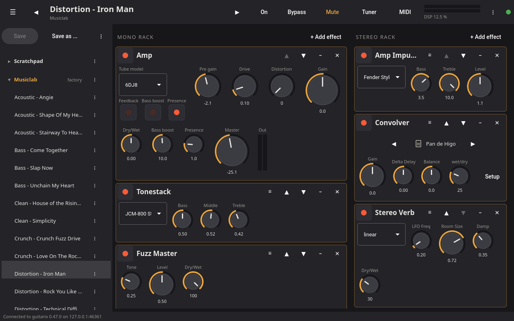

# guitariqx

[](https://github.com/kleag/guitariqx/actions/workflows/ci.yml)
[](https://kleag.github.io/guitariqx/)

A Qt Quick/QML user interface for [guitarix](https://github.com/brummer10/guitarix),
alongside its GTK `gx_head` one.

guitariqx is a pure client: it talks to a guitarix engine over the JSON-RPC
protocol (`trunk/src/gx_head/engine/jsonrpc.cpp` in the guitarix sources)
that `guitarix -G` already uses.
It does not link against any guitarix library and is built with CMake,
independently of guitarix's waf build. It only needs the free (LGPL) Qt 6 modules
Core, Gui, Network, Qml, Quick and QuickControls2.

Documentation: <https://kleag.github.io/guitariqx/>



## Install

An [apt repository](https://kleag.github.io/guitariqx/install/#with-apt)
serves Debian 12 "bookworm" and 13 "trixie" (also Raspberry Pi OS) and
Ubuntu 26.04, on x86_64 and arm64 (Raspberry Pi 4/5). The
[releases](https://github.com/kleag/guitariqx/releases) have the same
packages as files:

```sh
sudo apt install ./guitariqx_0.7.0-1.bookworm_arm64.deb
```

## Build

Requires Qt >= 6.4 and CMake >= 3.21.

Debian / Ubuntu / Raspberry Pi OS (Bookworm or newer):

```sh
sudo apt install cmake g++ qt6-base-dev qt6-declarative-dev \
    qml6-module-qtquick qml6-module-qtquick-controls qml6-module-qtquick-layouts \
    qml6-module-qtquick-window qml6-module-qtquick-templates qml6-module-qtqml-workerscript \
    qt6-wayland
```

`qt6-wayland` is only needed at run time, on Wayland desktops (e.g. Raspberry
Pi OS Bookworm on a Pi 5); without it Qt falls back to X11 or shows no window.

```sh
git clone https://github.com/kleag/guitariqx.git
cd guitariqx
cmake -B build -DCMAKE_BUILD_TYPE=Release
cmake --build build -j$(nproc)
sudo cmake --install build    # optional, installs /usr/local/bin/guitariqx
```

Tests: `ctest --test-dir build` (see the
[development documentation](https://kleag.github.io/guitariqx/development/)).

## Run

Start the engine headless with a JSON-RPC port, then the UI:

```sh
guitarix -N -p 7000 &
guitariqx -p 7000                # or: guitariqx -H raspberrypi.local -p 7000
```

The engine and the UI can run on different machines, e.g. the engine on a
Raspberry Pi attached to the audio interface and the UI on a laptop or
tablet. Options:

| option | |
|---|---|
| `-H`, `--host HOST` | engine host (default: the last engine connected to, else `localhost`) |
| `-p`, `--port PORT` | engine port (default: the last one, else `7000`) |
| `-f`, `--fullscreen` | full screen, for touch screens |
| `--skin NAME` | gx_head skin for this session, `""` for the flat look (default: the one chosen in the menu) |
| `--size WxH` | initial window size (default: the size, or maximized state, of the last session, else 1280x800) |
| `--dump` | print connection, preset and rack changes on the terminal |
| `--screenshot FILE` | save a screenshot after `--screenshot-delay` ms and quit (testing) |
| `--debug-state LIST` | testing without instrument or MIDI device: `tuner:HZ`, `switcher[:STATE]`, `learnmode`, `learn:PARAM`, `midimap`, `saveas`, `files:UNIT`, `skins`, `unit:UNIT`, `iredit:UNIT`, `sequencer`, `unitpresets:UNIT`, `rackdrag:UNIT`, `rackplace:UNIT` |

The connection indicator at the right of the top bar opens the connect
dialog. guitariqx reconnects automatically when the engine restarts.

### Files on a remote engine

Models and impulse responses are files of the computer the engine runs
on. guitariqx reads them directly when it runs on that computer too; for a
remote engine it needs an engine with JSON-RPC interface 1.2, which adds
the `list_directory` and `get_file_places` methods. With an older remote
engine the file chooser cannot list folders and asks for the path of the
file instead; everything else works. `GUITARIQX_REMOTE_FILES=1` makes guitariqx use the
engine's listing even when the engine is local, for testing.

The JSON-RPC port has no authentication: whoever can reach it can control
the engine, list directories and read audio files of its computer. Do not
make it reachable from untrusted networks.

### Raspberry Pi

guitariqx runs under the desktop, or without one directly on the display:

```sh
QT_QPA_PLATFORM=eglfs guitariqx -f -p 7000
```

Below 1100 px width (e.g. the official 7" 800x480 touch screen) the racks are
shown as tabs and the preset list as a drawer. All interactive items are at
least 40 px for touch use.

Without a physical keyboard, the desktop's on-screen keyboard (squeekboard
on Raspberry Pi OS) pops up when a text field gets the focus, and again on a
tap into the field after closing it. guitariqx asks for it over D-Bus
(`sm.puri.OSK0`, with `busctl`), as Qt before 6.7 (Bookworm has 6.4) cannot
make it appear by itself; on short screens the name dialogs open at the top,
above it. `GUITARIQX_SYSTEM_KEYBOARD=1` shows it even with a physical
keyboard, `=0` never. There is no on-screen keyboard under `eglfs`.

To test without a sound card, run the engine against a dummy JACK server
(`jackd -ddummy`) or PipeWire's JACK (`pw-jack guitarix -N -p 7000`).
`QT_QPA_PLATFORM=offscreen` runs the UI without a display.

## Design

```
src/rpcclient.*   JSON-RPC over TCP: newline framed messages, request ids,
                  notifications, reconnect
src/parameter.*   client mirror of a gx_engine::Parameter (from "parameterlist")
src/machine.*     engine proxy exposed to QML as the singleton "Gx"
                  (counterpart of GxMachineRemote in gx_head/gui/machine.cpp)
src/uitree.*      rack unit layouts: converts the UiBuilder call list
                  returned by plugin_load_ui into a tree for QML
src/tuner.*       tuner display: note, cents and target string from the
                  engine's frequency (Gx.tuner)
src/midimap.*     MIDI controller assignments and MIDI learn (Gx.midi)
qml/              views and controls
```

Notes on the protocol, as used by guitariqx:

- The server does not echo a `set` back to the connection it came from, so
  the client updates its own model when it sends a change.
- One `set` notification can carry several id/value pairs; `get_updates`
  (used to poll meters every 60 ms) answers with such a notification.
- Enum values are indexes in `set` notifications but value ids in `get`
  results.
- The server's JSON parser has no `true`/`false`: booleans are sent as 0/1.
- Meters flagged `[log]` report linear amplitudes; their range is the dB range
  to display.
- The tuner reports the frequency in `tuner_changed` notifications once
  `tuner_used_for_display` is on; note names, cents and strings are computed
  by the client from the reference pitch and temperament parameters.
- `midi_modifyCurrent` only works in MIDI config mode, which must be left
  again with `midi_set_config_mode`; `midi_changed` carries the whole map.
- `midi_value_changed [ctl, value]` is sent every 60 ms for the controllers
  that moved (to "midi" listeners); there is no RPC to ask for the current
  values (gx_head's `request_midi_value_update` has no server side).
- `get_midi_feedback` (like `get_last_midi_control_value`) answers with an
  object without key, `"result": {0}`, which is not JSON; `RpcClient` turns
  such a result into an array. The option is not broadcast.

## Status

Tested with Qt 6.10 on x86_64 against guitarix 0.47.0 (also built with
policy QTP0004 set to OLD, which is how Qt 6.4 behaves), and with Qt 6.4.2
on a Raspberry Pi 5 (Raspberry Pi OS Bookworm, arm64, Wayland desktop),
where the tuner and, partially, MIDI control were also checked.

Working:

- connection, engine state (on / bypass / mute), DSP load, output meters
- preset banks and presets, previous/next preset
- preset editing in the preset list: Save, Save as (to any writable bank,
  with an explicit replace), and per preset (⋮) save here, rename, copy to
  bank, move up/down, delete; per bank new, rename, move up/down, delete.
  Factory banks are read only, their presets can be copied.
  Bank files: "Load bank file" (⋮ of the preset list) imports a `.gx`
  file as a new bank, "Save to file" (⋮ of a bank) writes a bank to a
  `.gx` file; these files are on the computer guitariqx runs on, also when
  the engine runs elsewhere
- files: NAM and RTNeural models, convolver impulse responses and looper
  imports are chosen with a file chooser in KDE's single click style
  (a click on a folder opens it, a click on a file loads it) with places
  (home, model and IR folders, USB drives, recent folders) and a clickable
  path; the arrows next to the file step through its folder. Files are those
  of the engine's computer: when it runs elsewhere, the engine lists them
- mono and stereo racks: on/off, add, remove, reorder, collapse
- unit presets: load, save and remove the settings of one rack unit
- rack unit panels with gx_head's arrangement: the Glade layout of the
  unit when it has one (`plugin_load_ui` with `UI_FORM_GLADE`, translated
  by src/glade.cpp: boxes, grids, frames, notebooks, labels and the gxw
  knobs, sliders, switches, selectors, meters and displays, file buttons
  from the signal handlers), else its stack layout (`UI_FORM_STACK`), else
  a generic panel built from the unit's parameters.
  `GUITARIQX_FORM_STACK=1` uses the stack layouts, like
  `GUITARIX_FORM_STACK` for gx_head
- main amplifier panel
- special units: the looper's transport with the play head of each tape,
  the oscilloscope, the impulse response editor of the convolvers (level
  in dB, part used, delay, gain line, gain correction) and the drum
  sequencer
- tuner: full window, note, deviation needle, frequency, string tunings of
  gx_head, temperaments, reference pitch, mute while tuning. It follows the
  engine parameter `system.show_tuner`, so a MIDI foot switch assigned to
  the Tuner button opens and closes it
- preset by note (gx_head's Liveplay preset mode): from the menu or a MIDI
  foot switch, the engine mutes the output and the note played selects a
  bank or preset, shown full window with the notes to play
- MIDI learn: the MIDI button switches learn mode on, then a tap on any
  control (knobs, sliders, switches, selectors, unit power, preset
  previous/next, bypass, mute, tuner) opens the learn dialog; right click
  opens it at any time. Move a controller or type its number, set the range
  or toggle behaviour, connect or remove. The MIDI controllers dialog (menu)
  lists all assignments with the last value of their controller, sets the
  MIDI channel and MIDI feedback

Not yet:

- gx_head's slider and meter images, its two-tone unit backgrounds and its
  wallpapers, LV2/LADSPA plugin management

The full list is in [TODO.md](TODO.md).
