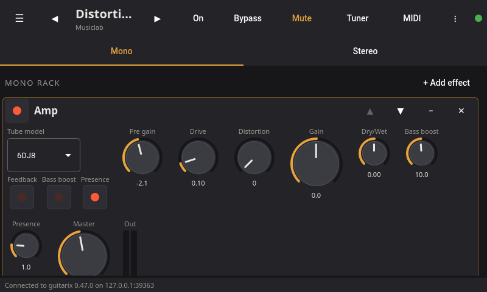
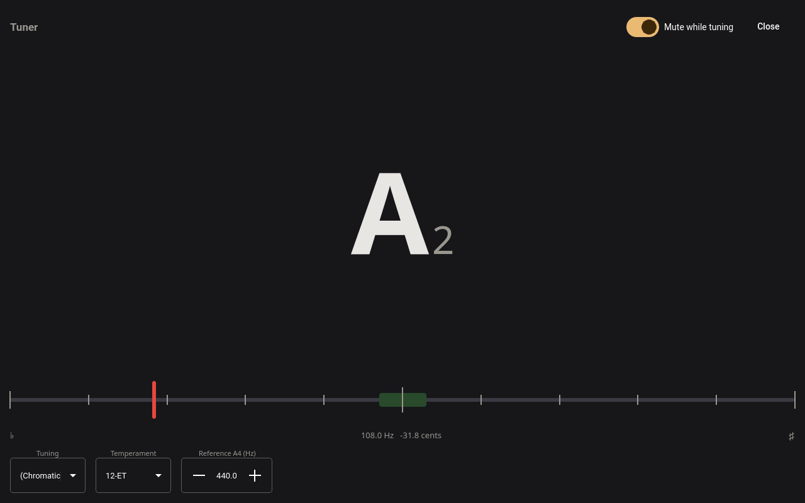

{ width="380" }
{ width="380" }

guitariqx is a Qt Quick user interface for the
[guitarix](https://github.com/brummer10/guitarix) virtual guitar amplifier,
an alternative to its GTK interface `gx_head`. It is made for touch screens,
such as those of the Raspberry Pi, as well as for desktops.

guitariqx is a pure client: it controls a guitarix engine started without
its own interface (`guitarix -N -p 7000`) over the engine's JSON-RPC
protocol, on the same computer or over the network. It does not link
against any guitarix library and only needs the free (LGPL) Qt 6 modules.
A typical setup is the engine on a Raspberry Pi attached to the audio
interface, with its touch screen, a laptop or a tablet as the interface.

- **Presets**: banks and presets, previous/next, save, rename, copy, reorder,
  import and export of bank files.
- **Racks**: mono and stereo racks with gx_head's unit layouts, add, remove,
  reorder and collapse units, LADSPA and LV2 plugins as units.
- **Tuner**: full window tuner with gx_head's tunings and temperaments.
- **MIDI learn**: assign a MIDI controller to any control by moving it.
- **Files**: neural amp models (NAM, RTNeural) and impulse responses chosen
  on the computer the engine runs on.
- **Touch first**: everything works with a finger; below 1100 pixels wide
  the racks become tabs and the preset list a drawer.

{ width="400" }
{ width="400" }

Get it from the [installation page](install.md), then see
[how to run it](usage.md).

guitariqx is free software under the GNU General Public License, version 2
or later. The source is on [GitHub](https://github.com/kleag/guitariqx).
