# Usage

## Starting

Start the engine without its own interface, with a JSON-RPC port, then the
interface:

```sh
guitarix -N -p 7000 &
guitariqx -p 7000                # or: guitariqx -H raspberrypi.local -p 7000
```

The engine and the interface can run on different computers, e.g. the
engine on a Raspberry Pi attached to the audio interface and guitariqx on a
laptop or tablet.

| option | |
|---|---|
| `-H`, `--host HOST` | engine host (default: the last engine connected to, else `localhost`) |
| `-p`, `--port PORT` | engine port (default: the last one, else `7000`) |
| `-f`, `--fullscreen` | full screen, for touch screens |
| `--skin NAME` | gx_head skin for this session, `""` for the flat look (default: the one chosen in the menu) |
| `--size WxH` | initial window size (default: the size, or maximized state, of the last session, else 1280x800) |
| `--dump` | print connection, preset and rack changes on the terminal |
| `--screenshot FILE` | save a screenshot after `--screenshot-delay` ms and quit (testing) |
| `--debug-state LIST` | open UI states for testing without instrument or MIDI device, see [Development](development.md#ui-states-for-testing) |

The connection indicator at the right of the top bar opens the connect
dialog. "Full screen" in the top bar menu (⋮), or F11, switches between
full screen and a window at any time (not under `eglfs` or `linuxfb`, which
are always full screen). guitariqx reconnects by itself when the engine restarts.

guitariqx remembers the last engine, the window size and the tuner's "mute
while tuning" option, with the recent folders of the file chooser, in
`~/.config/guitarix/guitariqx.conf`.

!!! warning "Security"
    The engine's JSON-RPC port has no authentication: whoever can reach it
    can control the engine, list directories and read audio files of its
    computer. Do not make it reachable from untrusted networks.

## Raspberry Pi

guitariqx runs under the desktop, or without one directly on the display:

```sh
QT_QPA_PLATFORM=eglfs guitariqx -f -p 7000
```

Below 1100 pixels width (e.g. the official 7" 800x480 touch screen) the
racks are shown as tabs and the preset list as a drawer, and rack units
too wide for the screen wrap their controls onto several rows. All interactive
items are at least 40 pixels for touch use.

Without a physical keyboard, the desktop's on-screen keyboard (squeekboard
on Raspberry Pi OS) pops up when a text field gets the focus, and again on a
tap into the field after closing it. guitariqx asks for it over D-Bus
(`sm.puri.OSK0`, with `busctl`), as Qt before 6.7 (Bookworm has 6.4) cannot
make it appear by itself; on short screens the name dialogs open at the top,
above it. `GUITARIQX_SYSTEM_KEYBOARD=1` shows it even with a physical
keyboard, `=0` never. There is no on-screen keyboard under `eglfs`.

To try it without a sound card, run the engine against a dummy JACK server
(`jackd -ddummy`) or PipeWire's JACK (`pw-jack guitarix -N -p 7000`).

## Presets

The preset list shows the banks and their presets; a tap loads a preset,
the arrows of the top bar step through the bank. **Save** writes the
current settings into the loaded preset, **Save as** into a new or existing
preset of any writable bank.

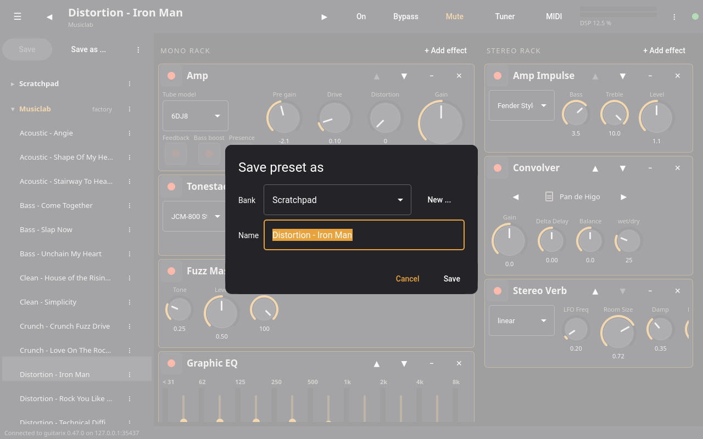

The ⋮ menu of a preset saves into it, renames, copies it to another bank,
moves it or deletes it; the one of a bank creates, renames, moves, deletes
or saves the bank to a file. Factory banks are read only, but their
presets can be copied. "Load bank file" in the ⋮ menu of the list imports a
`.gx` file as a new bank. Bank files are on the computer guitariqx runs on,
also when the engine runs elsewhere.

## Racks

**+ Add effect** adds a unit at the top of the mono or stereo rack. Each unit has its
power switch, buttons to open its presets (≡), to move it up and down, to
collapse it to a compact view and to remove it. A unit can also be dragged
to another place of its rack by the grip (⠿) at the left of its title bar,
or by holding its title bar for a moment and then dragging; a line shows
where it goes, and the rack scrolls when the unit is held near its top or
bottom. With **Then place it by hand** switched on in the **+ Add effect**
dialog, an added unit starts in that dragged state: touching the rack moves
it, lifting the finger drops it there, and **Keep here** leaves it at the
top. Units are shown with
gx_head's arrangement: the Glade layout of the unit when it has one, else
its stack layout, else a generic panel built from the unit's parameters.
`GUITARIQX_FORM_STACK=1` uses the stack layouts, like `GUITARIX_FORM_STACK`
for gx_head.

The presets of a unit keep the settings of that unit only, apart from the
banks. Tapping one loads it into the unit (the one in use is checked),
**Default settings** gives back the unit's standard values, **Save…** keeps
the unit's current settings under a name, and ✕ removes one of your
presets. Factory presets come with guitarix.

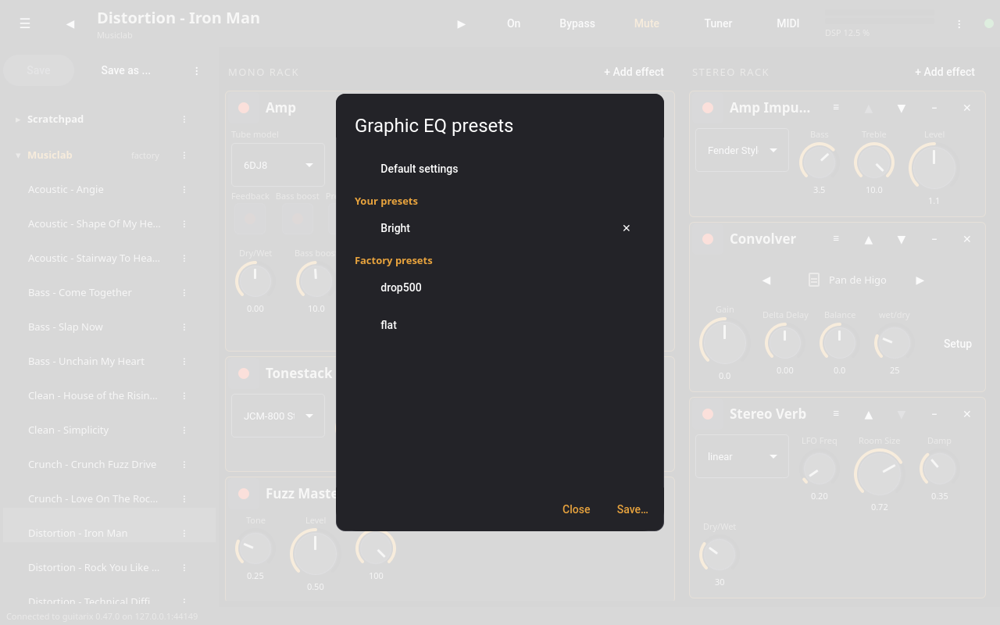

**Skin ...** in the menu (⋮) switches the rack units between guitariqx's
flat look and gx_head's skins: the skin's background between rack handles,
its knob images with their LED rings, its switch icons and colors. The
Guitarix skin is built into guitariqx; the other skins are those of an
installed guitarix (`gx_head/skins` in the data directories, e.g.
`/usr/share/gx_head/skins`), so they are offered only where guitarix is
installed. The choice is remembered.

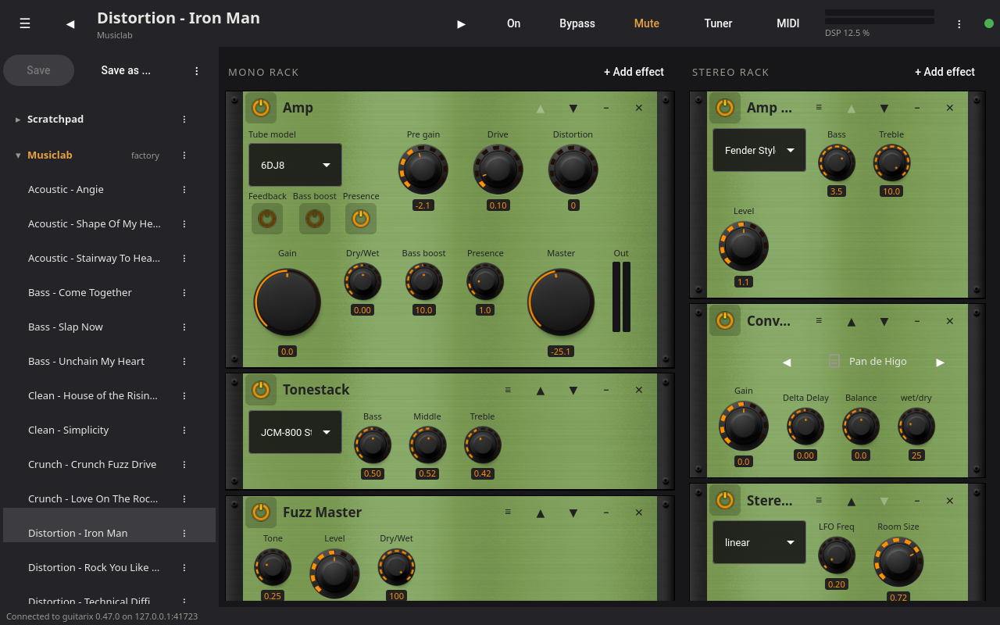

### Special units

Some units have widgets of their own, as in gx_head:

- **Live Looper**: each tape has record, play, reverse, erase and overdub
  switches, a file button to import a loop, and the play head over the
  tape, the part between cut and clip lit.
- **Oscilloscope**: the signal at the unit's place in the rack while the
  unit is on; **Buffer** sets how many jack periods are shown, **Zoom**
  the vertical scale.
- **Convolver** (mono and stereo): **Setup** opens the impulse response
  editor. It shows the level of the response in dB; the brackets above it
  (or the Start and Length fields) set the part of the file used, Delay
  delays it. The yellow gain line shapes the response: tap on the line to
  add a point, drag points, select one and tap **Remove point** (or double
  click it). **Gain correction** normalizes the level of the result,
  **Reset** goes back to the whole file without gain line, **Apply** sends
  the changes to the engine.
- **DrumSequencer**: **Setup** opens the sequencer: one line of steps per
  drum (tap a step to switch it), the beats lit, tempo, beat, number of
  steps, the level of each drum, humanize, follow (keeps the play head in
  view), and buttons to move the stepper (to the start, a beat back, back
  on the beat, a beat forward). ◀ and ▶ load the previous or next of your
  presets of the sequencer, **Presets…** lists them. guitariqx also follows
  the sequencer's "Load next/previous unit preset" controls when another
  client (or a MIDI controller assigned to them in gx_head) sets them.

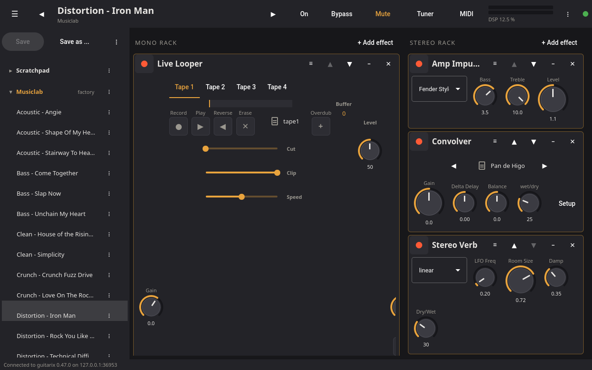

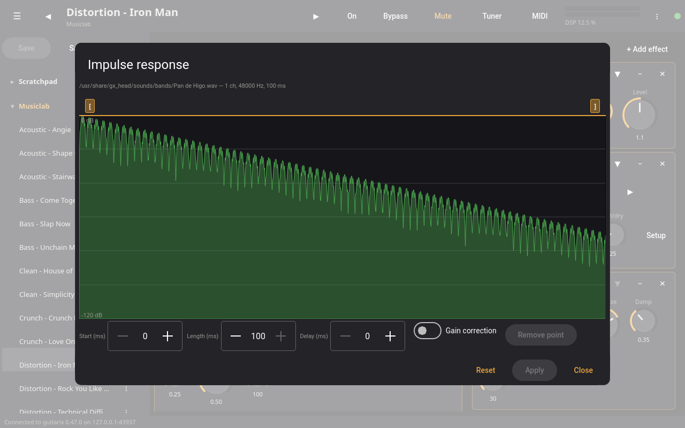

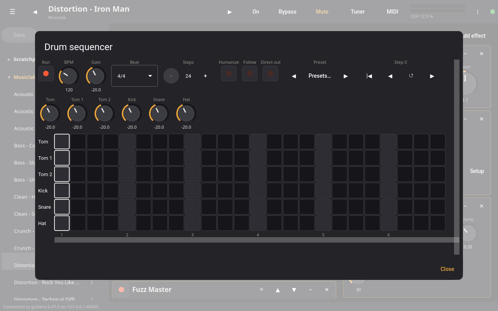

## Files

Neural amp models (NAM and RTNeural) and impulse responses of the
convolvers are files of the computer the engine runs on. The file chooser
opens a folder or loads a file with a single tap; it lists places (home,
model and IR folders, USB drives, recent folders) and a clickable path; the
arrows next to a file control step through its folder.

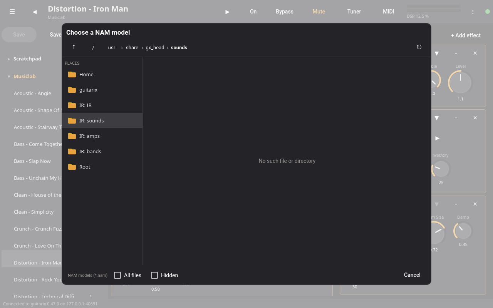

guitariqx reads the files directly when it runs on the engine's computer.
For a remote engine it needs an engine with JSON-RPC interface 1.2, which
adds the `list_directory` and `get_file_places` methods. With an older
remote engine (such as guitarix 0.47.0) the file chooser cannot list
folders and asks for the path of the file instead; everything else works.

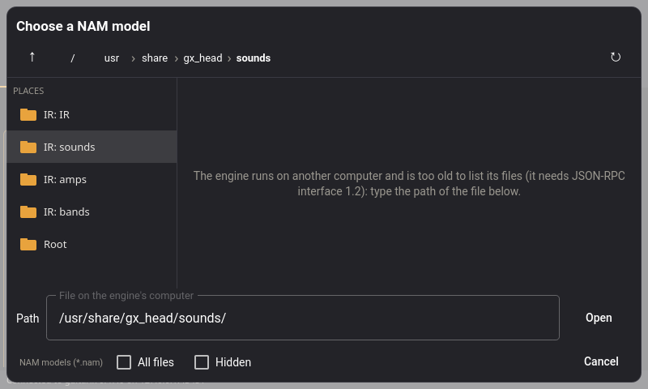{ width="400" }

`GUITARIQX_REMOTE_FILES=1` makes guitariqx use the engine's listing even
when the engine is local, for testing.

## Tuner

**Tuner** opens the full window tuner: note, deviation, frequency, the
string tunings of gx_head, temperaments, reference pitch, and mute while
tuning. It follows the engine parameter `system.show_tuner`, so a MIDI foot
switch assigned to the Tuner button opens and closes it. Mute while tuning
stops the engine while the tuner is shown and restores its state when the
tuner closes, or when guitariqx quits with the tuner open.

## Preset by note

gx_head's Liveplay preset mode: **Preset by note ...** in the menu, or a
MIDI foot switch assigned to it (in learn mode, tap the menu entry), mutes
the output and lets the note played on the guitar choose what to load. Mute
the strings first, then play:

| notes | |
|---|---|
| A2 to A#3 | a bank, starting from the last one |
| B3 to E5 | preset 1 to 18 of the bank |
| G2 / G#2 | bypass / mute (or back on) |
| below G2, F5 to A#6 | the tuner |

The selection is loaded when the note stops. The view lists which note
selects which bank and preset. Pressing the foot switch again, or Cancel,
leaves without loading anything; with the tuner shown, the foot switch
closes it. The engine does the selection, so the foot switch works without
any UI too.

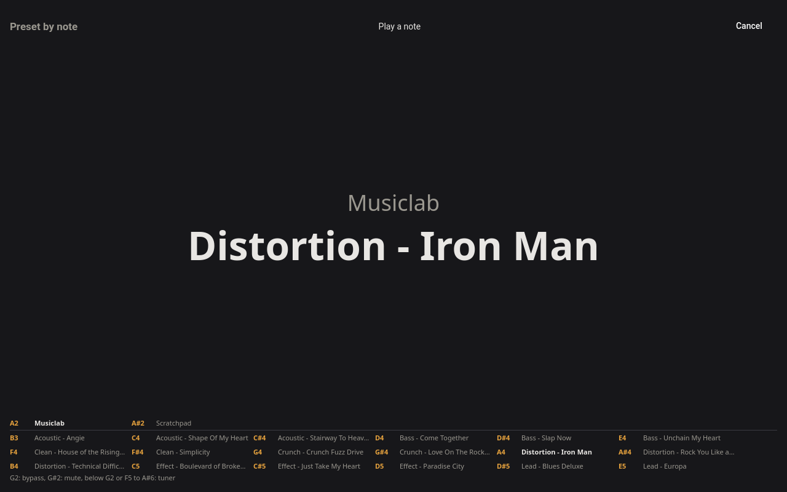

## MIDI learn

The **MIDI** button switches learn mode on: a tap on any control (knobs,
sliders, switches, selectors, unit power, preset previous/next, bypass,
mute, tuner) then opens the learn dialog. A right click opens it at any
time.

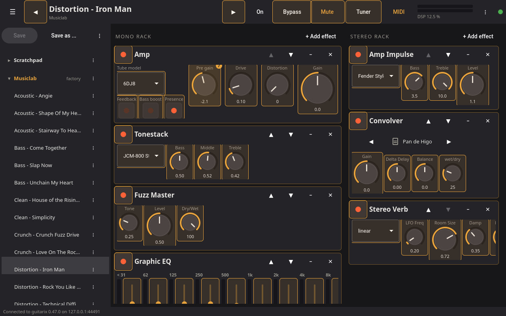

Move a controller or type its number, set the range (for continuous
controls) or the toggle behaviour (for switches), then connect or remove
the assignment. A bar shows the value the controller sends, to check that
it arrives.

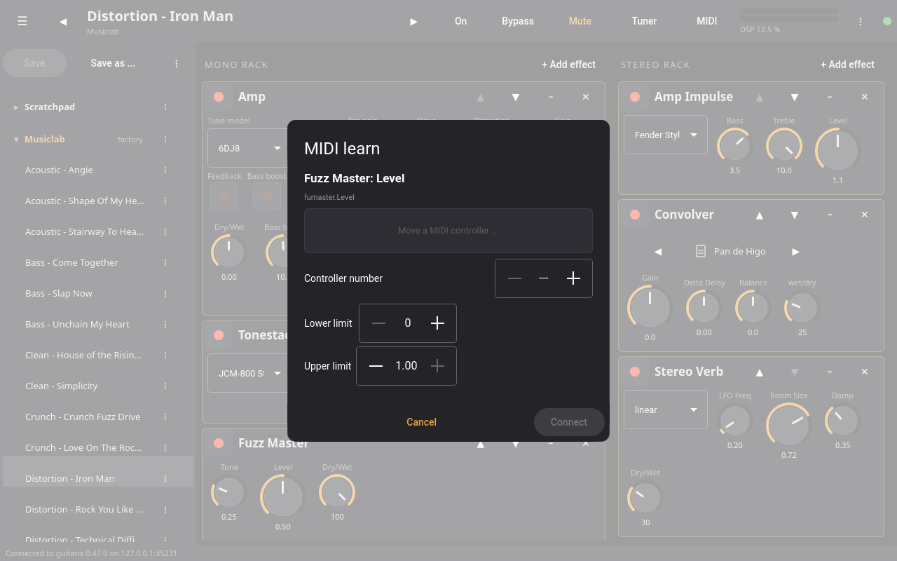

"MIDI controllers" in the menu lists all assignments, with a bar showing
the last value each controller sent, and sets the MIDI channel. **MIDI
feedback** makes the engine send the values of the assigned parameters to
its MIDI output when a preset loads or a controller changes them, so that
controllers with LEDs or motor faders follow (changes made in the UI are
not sent).

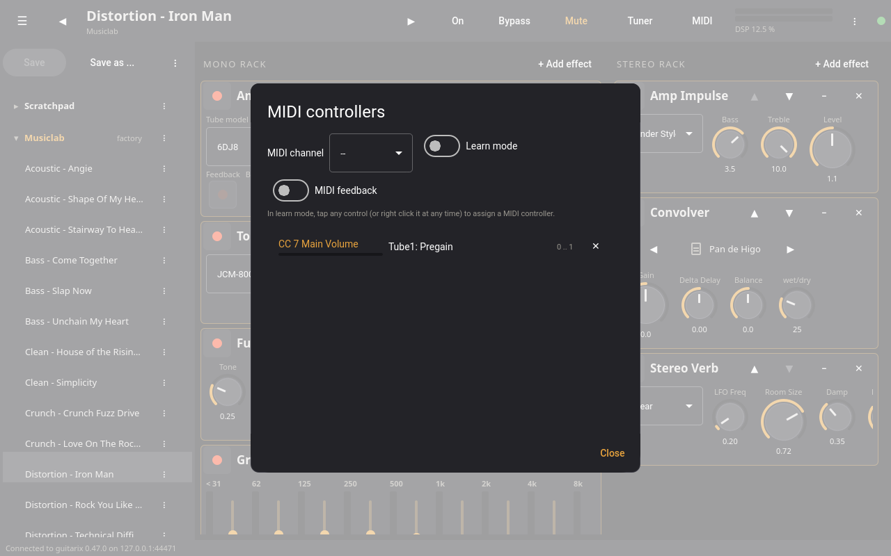
